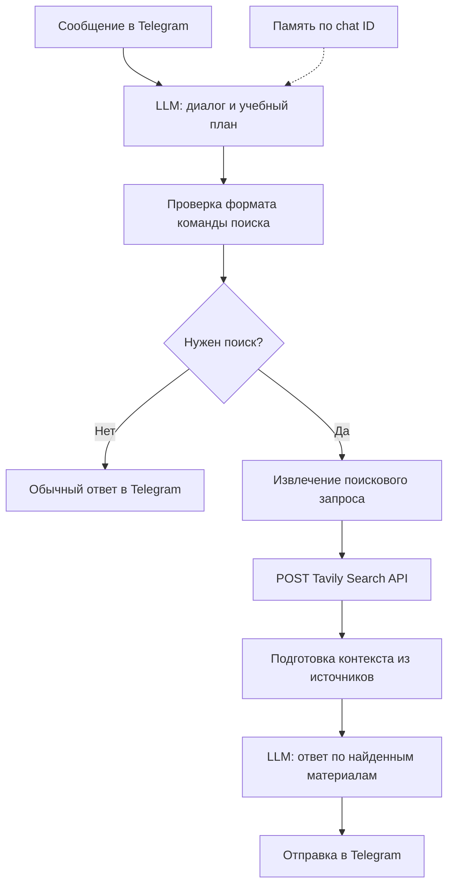

# ИИ-ментор в Telegram на n8n

Прототип помощника для обучения, объединяющий Telegram, LLM и поисковый API Tavily.

## Задача

Помочь пользователю выбрать тему обучения, обозначить уровень подготовки, получить план и изучать материал в привычном интерфейсе Telegram.

## Мой вклад

- Спроектировала сценарий диалога и переход от общения к поиску материалов.
- Настроила Telegram Trigger и отправку ответов в Telegram-бот.
- Сформулировала инструкции для LLM: уточнение цели и уровня знаний, план из пяти тем, подтверждение плана пользователем.
- Подключила память диалога с ключом сессии по Telegram chat ID.
- Настроила интеграцию с Tavily Search через HTTP POST и передачу запроса в JSON.
- Использовала JavaScript-ноды для распознавания команды поиска, извлечения запроса и подготовки контекста из результатов поиска.
- Настроила отдельный этап формирования ответа LLM на основе найденных материалов.

## Как работает процесс

Проверка команды и вызов поиска выполняются нодами workflow. Строка `tavily(query="...")` служит сигналом маршрутизации; это не нативный tool call модели.

## Интеграции

| Компонент | Назначение |
|---|---|
| Telegram | Приём сообщений и отправка ответов |
| LLM, две ноды | Диалог с пользователем и подготовка ответа по источникам |
| Tavily Search API | Поиск материалов через `POST https://api.tavily.com/search` |
| Simple Memory | Контекст диалога, ключ сессии — chat ID |
| JavaScript | Проверка команды, извлечение запроса, преобразование результатов |

В исходной конфигурации выбран идентификатор модели `GigaChat/GigaChat-2-Max` в нодах OpenAI Chat Model. Для запуска необходимо настроить совместимого провайдера и его адрес либо выбрать доступную модель; один идентификатор модели не подтверждает доступность подключения.

## Пример сценария

Иллюстрация предполагаемого поведения, не запись тестового запуска:

1. Пользователь сообщает, что хочет изучать REST API с нуля.
2. Агент уточняет уровень знаний и предлагает план из пяти тем.
3. Пользователь подтверждает план и просит материал по первой теме.
4. Агент формирует поисковую команду; workflow извлекает запрос и обращается к Tavily.
5. Вторая LLM получает заголовки, ссылки и содержание результатов и формирует ответ для Telegram.

## Содержимое репозитория

- [Workflow для импорта](ai-mentor.json).
- [Развёрнутый кейс](case-study.md).
- [Настройка и запуск](setup.md).
- [Сценарии проверки](verification.md).

## Что показывает проект

Проект демонстрирует проектирование интеграционного сценария: передачу данных между Telegram, LLM и поисковым API, разделение этапов обработки, работу с JSON и маршрутизацию процесса в n8n.

## Ограничения

- План обучения и запрет повторов заданы в промпте; отдельного постоянного хранилища прогресса нет.
- Буфер памяти не гарантирует сохранение всех изученных тем или контекста после перезапуска.
- Расписание автоматической отправки уроков отсутствует: сценарий запускается сообщением пользователя.
- Распознавание поиска зависит от текстового формата ответа LLM; проверка и извлечение команды имеют разные правила для кавычек.
- В workflow нет отдельной ветки обработки ошибок и повторных запросов к Tavily.
- Инструкция опираться на источники не гарантирует точность ответа; автоматическая проверка фактов не реализована.

## Дальнейшее развитие

Хранение учебного плана и прогресса, структурированный ответ модели вместо текстовой команды, обработка ошибок внешних API, ссылки на источники в ответе и проверка сценариев на тестовых диалогах.

## Подготовка публикационной версии

Из экспорта удалены API-ключ, ссылки на учётные данные, webhook ID, служебные метаданные и закреплённые данные выполнения. Workflow выключен по умолчанию. В копии исправлена сборка JSON-запроса Tavily и интерполяция количества источников. Исходный файл не изменялся.

В репозитории нет данных рабочих проектов, переписок пользователей или результатов запусков. Перед использованием укажите собственные учётные данные в n8n.
